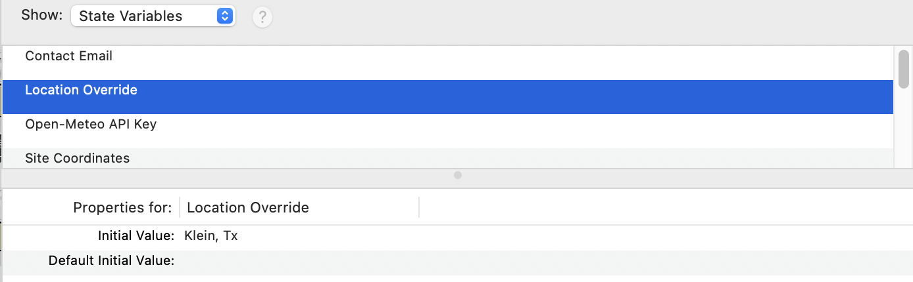
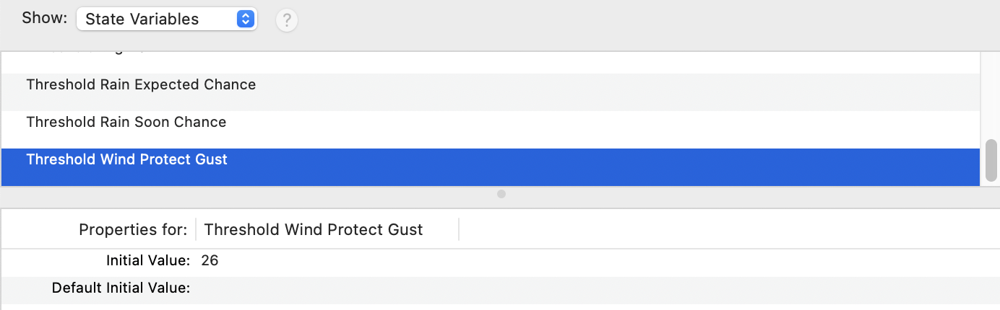
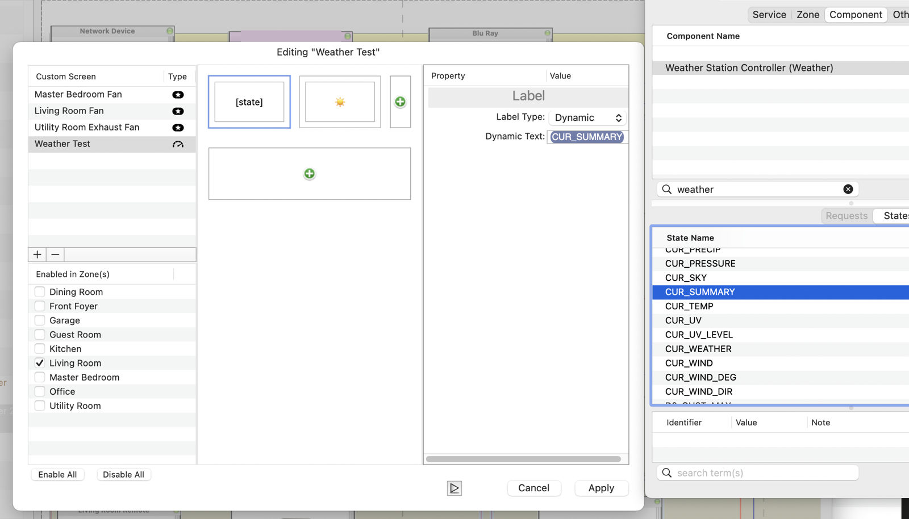
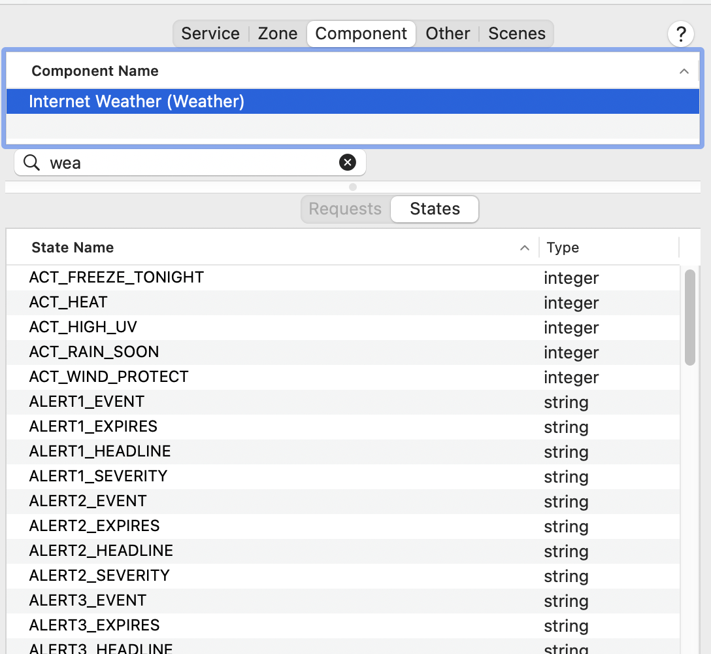
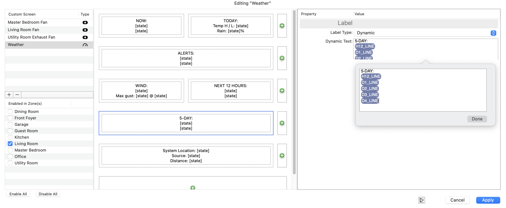
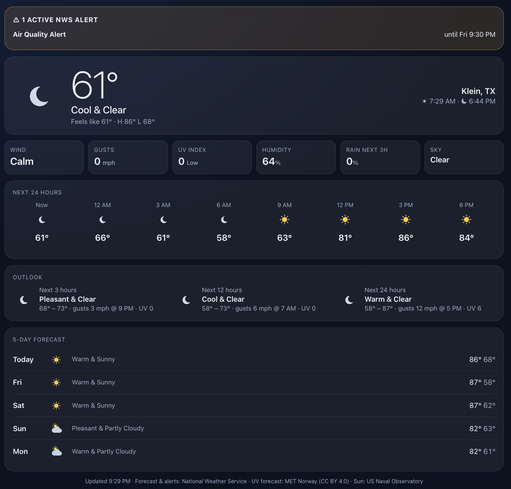
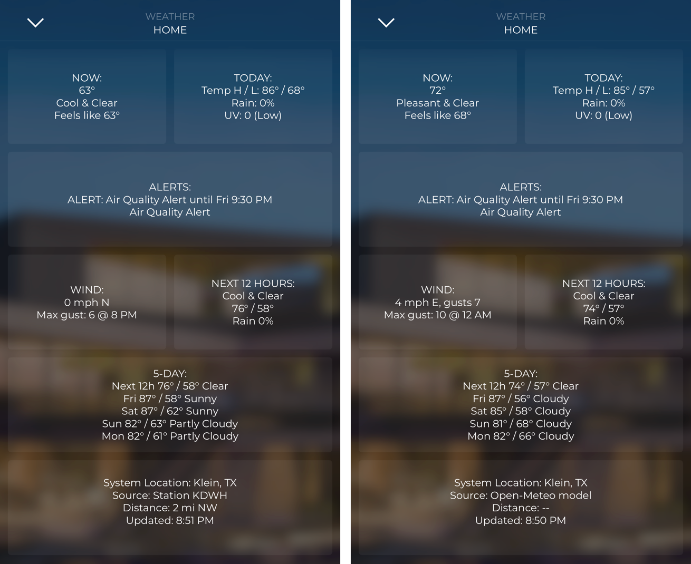

# Savant OpenWx — User Manual

**Version 2.0.2** · Weather, forecast and severe-weather alerts for Savant, as plain states you can show on custom screens and use in triggers.

*Savant OpenWx is an independent community project. It is not affiliated with, endorsed by, or supported by Savant Systems, Inc. "Savant" is a trademark of Savant Systems, Inc. Released under the MIT License.*


---

## Contents

1. [What it does](#1-what-it-does)
2. [How it works](#2-how-it-works)
3. [Requirements](#3-requirements)
4. [Quick start](#4-quick-start)
5. [Installing the bridge](#5-installing-the-bridge)
6. [Adding the profile in Blueprint](#6-adding-the-profile-in-blueprint)
7. [Settings you enter in Blueprint](#7-settings-you-enter-in-blueprint)
8. [Showing weather in the Savant app](#8-showing-weather-in-the-savant-app)
9. [Automations](#9-automations)
10. [Data sources and licensing](#10-data-sources-and-licensing)
11. [Managing the bridge](#11-managing-the-bridge)
12. [Troubleshooting](#12-troubleshooting)
13. [FAQ](#13-faq)
14. [Developer reference](#14-developer-reference)
15. [Appendix A — State reference](#appendix-a--state-reference)

---

## 1. What it does

Savant OpenWx gives a Savant system **248 weather states**, refreshed every 5 minutes:

- **Current conditions**: temperature, feels-like, humidity, dew point, wind, gusts, UV, cloud cover, pressure, plus plain-language summaries such as "Pleasant & Partly Cloudy".
- **Forecasts**: the next 3, 12 and 24 hours, an hourly strip, and 5 days.
- **Sunrise, sunset, dawn and dusk.**
- **National Weather Service watches, warnings and advisories**, with yes/no flags per category (wind, freeze, tornado, flood, heat, tropical and more).
- **Ready-to-display text** for custom-screen labels ("87°", "Thu 84° / 68° Stormy 70%").
- **Automation flags** with thresholds you set per job: protect shades from wind, rain coming, freeze tonight, high UV, heat.

Typical uses: retract awnings before gusts arrive, run pool freeze protection, close a motorized pergola before rain, lower solar shades on high-UV days, push a notification when a tornado warning is issued, and show a weather page in the Savant app.

**Free to use, including on client jobs (US):** by default all data comes from US government sources (National Weather Service, EPA, US Naval Observatory) plus MET Norway, with no account or key needed. Outside the US, or if you prefer it, enter an Open-Meteo API key.

---

## 2. How it works

```
 Internet (HTTPS)                    Site network                      Savant
┌───────────────────┐   every    ┌──────────────────────┐  TCP 2350  ┌────────────────────────┐
│ NWS forecast,     │◄── 5 min ──│  OpenWx bridge       │◄──────────►│ OpenWx profile         │
│  observations and │            │  (service on the     │ KEY=value  │  248 states            │
│  alerts; EPA and  │            │   Savant Mac host or │   lines    │  labels, triggers,     │
│  MET Norway UV;   │            │   a Linux box)       │            │  workflows             │
│  USNO sun times   │            │  - dashboard :8642   │◄── HTTP ───│  (optional web view)   │
│ or Open-Meteo key │            └──────────────────────┘            └────────────────────────┘
└───────────────────┘
```

A Savant profile can only talk plain TCP and match simple text, so it can't call modern HTTPS/JSON weather services directly. OpenWx has two parts:

- **The bridge**: a small Python service (standard library only, no installs) that runs on the Savant Mac mini Pro host (or any Linux machine on the network). It fetches the weather, does the math ("highest gust in the next 12 hours"), and sends Savant one simple line per value, e.g. `H12_GUST_MAX=34`. Only changed values are sent.
- **The profile** (`openwx_weatherbridge.xml`): a Blueprint component profile of class *Weather Station Controller* that connects to the bridge and turns each line into a Savant state. It also sends your Blueprint settings (location, contact email, thresholds…) to the bridge when the host starts.

---

## 3. Requirements

| | |
|---|---|
| Savant | Blueprint with custom-screen support. Developed and tested on a Savant Mac mini Pro host (macOS, Python 3.9.6). |
| Bridge machine | The Savant **Mac mini Pro host** (recommended), or any always-on macOS/Linux machine on the same network. |
| Python | 3.6 or newer. macOS 11+ includes Python 3.9 with the Command Line Tools (`xcode-select --install` if `python3 --version` asks). |
| Network | Outbound HTTPS from the bridge machine. Ports **2350** (Savant ↔ bridge) and **8642** (dashboard) free on the bridge machine. Savant itself uses port 80, so OpenWx doesn't. |
| Location | US for the free data sources. Anywhere with an Open-Meteo API key. |

Not yet tested: Savant Smart Hosts / Linux-based Pro hosts. The bridge runs on Linux, but installing software on those hosts isn't covered here.

---

## 4. Quick start

1. Copy the unzipped `savant-openwx` folder to the Savant Mac host.
2. In Terminal: `cd savant-openwx/macos` then `sudo ./install.sh`.
3. Check it: `openwx probe 77002` (any ZIP). You should see current weather and `SYS_ONLINE 1`.
4. In Blueprint, import `profile/blueprint-import/openwx_weatherbridge.xml` (keep that exact file name) and drag **OpenWx WeatherBridge** into the layout.
5. Inspector → *Control Ports* → set the Ethernet **Device IP Address** to the host's own IP.
6. Inspector → *State Variables* → enter **Location Override** (a ZIP code works best) and **Contact Email**.
7. Upload the configuration.
8. Build a custom screen with dynamic labels (section 8) and add triggers (section 9).

---

## 5. Installing the bridge

### 5.1 On the Savant Mac mini Pro host (recommended)

1. Copy the unzipped `savant-openwx` folder to the host (AirDrop, USB, or `scp`). Remove any older copy first, so macOS doesn't save the new one as `savant-openwx 2`.
2. Open Terminal and run:
   ```
   cd ~/Downloads/savant-openwx/macos      # wherever you put it
   sudo ./install.sh
   ```
   If the zip lost the execute permission, use `sudo bash install.sh`. To run the service as a specific account: `sudo ./install.sh --user RPM`.

The installer:
- Finds Python 3 and checks that ports 2350 and 8642 are free (it stops with a clear message if anything, including Savant, already uses them).
- Installs to `~/OpenWx` (bridge, dashboard, `config.json`, logs).
- Registers a background service, `org.openwx.bridge`, that starts at boot without anyone logged in, restarts itself after a crash, and runs at low priority so it never competes with Savant.
- Adds the `openwx` control command.
- Allows Python through the macOS firewall if the firewall is on (only if Python wasn't already allowed).
- Starts the bridge, confirms it's listening, and prints the host IP, dashboard address and commands.

**Upgrading:** run the new release's `install.sh` the same way. Your `config.json` and saved settings are kept, and the installer prints `Installing bridge vX (replacing vY)`.

**Backups before installing:** none needed. The installer doesn't modify Savant or the system Python, and records exactly what it adds so the uninstaller can remove it (section 11.3).

### 5.2 On Linux (Raspberry Pi, NUC, server)

```
sudo mkdir -p /opt/openwx
sudo cp bridge/* /opt/openwx/
sudo cp linux/openwx-bridge.service /etc/systemd/system/
sudo nano /etc/systemd/system/openwx-bridge.service   # set User= to the account that should run it
sudo chown -R <that user> /opt/openwx
sudo systemctl daemon-reload
sudo systemctl enable --now openwx-bridge
journalctl -u openwx-bridge -f
```

Give the machine a DHCP reservation and use its IP in Blueprint. `sudo systemctl stop openwx-bridge` performs a clean shutdown. The `openwx` command is macOS-only; on Linux, test with `python3 /opt/openwx/openwx_bridge.py -c /opt/openwx/config.json --probe 77002`.

### 5.3 Checking that it works

| Check | Command / place | Expect |
|---|---|---|
| Service running | `openwx status` | `running`, the version, both ports `listening`, location and current weather |
| Live data | `openwx probe 77002` | Current weather, sources, station, sun times, alerts; `SYS_ONLINE 1` |
| Dashboard | `http://<host-ip>:8642/` in any browser | Weather page (section 8.5) |
| Log | `openwx logs` | `savant connected` once the Savant host is running the profile |

### 5.4 The bridge's configuration file

`~/OpenWx/config.json` (macOS) or `/opt/openwx/config.json` (Linux). Most of it is a **fallback**: anything you enter in Blueprint (section 7) takes priority. After editing, run `sudo openwx restart`.

| Key | Default | Purpose |
|---|---|---|
| `default_location` | `77002` | Location used when Blueprint sends none (ZIP, `lat,lon`, or `City, ST`) |
| `contact_email` | placeholder | Contact sent to the data providers when Blueprint's *Contact Email* is blank |
| `openmeteo_api_key` | blank | Fallback Open-Meteo key (or `private`) |
| `forecast_source` | `auto` | `auto` = Open-Meteo when a key is set, otherwise NWS. `nws` or `openmeteo` forces one |
| `units` | `imperial` | `imperial` (°F, mph, in) or `metric` (°C, km/h, mm) |
| `refresh_seconds` | `300` | Update interval (minimum 60) |
| `thresholds` | see section 7 | Default automation thresholds, plus `wind_icon_gust` (30 mph; when the `*_ICON` value becomes `wind`) |
| `tcp_port` / `http_port` | `2350` / `8642` | Savant connection / dashboard ports. The profile expects 2350 |
| `max_memory_mb` | `150` | Memory watchdog limit (normal use is about 25 MB) |

---

## 6. Adding the profile in Blueprint

### 6.1 Import and add the component

1. In Blueprint's component library, use **Import** to add `profile/blueprint-import/openwx_weatherbridge.xml`.
   - **Upgrading from 2.0.0:** delete the older OpenWx entry from the library first, then import. Earlier releases had the profile directly in `profile/`.
   - **Import it from that folder.** Blueprint also copies in this manual (`openwx_weatherbridge.htm`), shown on the component's **Documentation** tab, and the component icon (`openwx_weatherbridge.icns`), but only from beside the `.xml`. Keep the three files together.
   - **Keep the file name exactly as shipped.** Blueprint finds profiles by a file name built from the manufacturer and model (all lowercase, everything that isn't a letter or digit turned into `_`). A renamed file, including a browser download saved as `openwx_weatherbridge (1).xml`, imports and shows in the library but fails with **"Component not found"** when dragged into the layout.
2. Search the library for *OpenWx* and drag **OpenWx WeatherBridge** into the layout. Blueprint names it *Weather Station Controller*; rename it if you like (for example *Internet Weather*).
3. Connect its **Ethernet** port to your network, as you would any IP device.

### 6.2 Point it at the bridge

Select the component → Inspector → **Show: Control Ports** → *Ethernet*:
- **Device IP Address or URL**: the IP of the machine running the bridge. On a Mac host that's the host's own IP (`ipconfig getifaddr en0` in Terminal shows it).
- **Control Port**: 2350, set by the profile and greyed out. That's expected.

### 6.3 Enter settings, then upload

Inspector → **Show: State Variables** → select each setting and type its **Initial Value**. Section 7 lists every setting. At minimum, enter a **Location Override** (or **Site Coordinates**) and your **Contact Email**. Then upload the configuration.



When the host starts, the profile connects to the bridge and sends all settings. To watch it happen, run `openwx logs` on the host before uploading. You should see:

```
savant connected: ('127.0.0.1', ...)
cmd: OVERRIDE 77379
location: 77379 (Spring, TX) -> 30.0377, -95.5326 [override]
updated: 73 Pleasant & Clear, Spring, TX
cmd: PING            (every minute after that)
```

### 6.4 Confirm the states reached Savant

On the host, read a state with Savant's `sclibridge` tool. The state name is `<component name>.Weather.<STATE>`:

```
sclibridge readstate "Weather Station Controller.Weather.CUR_SUMMARY"
→ Pleasant & Clear
```

### 6.5 Profile actions

These appear under the component's custom actions for workflows. The first five also run automatically at startup.

| Action | What it does | Runs automatically |
|---|---|---|
| `SendSiteCoordinates` | Sends *Site Coordinates* | At startup |
| `SendLocationOverride` | Sends *Location Override* | At startup |
| `SendContactEmail` | Sends *Contact Email* | At startup |
| `SendApiKey` | Sends *Open-Meteo API Key* | At startup |
| `SendThresholds` | Sends all six thresholds | At startup |
| `ClearLocationOverride` | Returns to Site Coordinates / default | — |
| `RefreshWeather` | Fetches weather now (the bridge also refreshes every 5 minutes on its own) | — |
| `RequestAllStates` | Re-sends every state | — |
| `Ping` | Keepalive | Every 60 s |

**Changing a setting while the system is running** (for example from a custom screen or workflow): write the new value to the component's state variable, then run the matching `Send…` action.

---

## 7. Settings you enter in Blueprint

All settings live in **Inspector → State Variables** on the OpenWx component. Every one is optional. A blank field falls back to the bridge's `config.json`, so each job only needs what's different. Values are sent at startup and saved on the bridge, so they survive bridge restarts.



| Setting | What to enter | Example | If blank |
|---|---|---|---|
| **Site Coordinates** | The job site as `latitude,longitude` | `30.0377,-95.5326` | Not used |
| **Location Override** | ZIP code, `lat,lon`, or `City, ST`. Takes priority over Site Coordinates | `77379` / `Spring, TX` | Site Coordinates, then `default_location` |
| **Contact Email** | Your company email. The NWS, EPA, MET Norway and USNO ask for contact info with each request | `service@yourdomain.com` | `contact_email` from `config.json` |
| **Open-Meteo API Key** | Your Open-Meteo key, or the word `private` (section 10.2) | `aBcD1234…` | Free NWS-based forecast (US only) |
| **Threshold Wind Protect Gust** | mph that turns on `ACT_WIND_PROTECT` | `25` | 25 |
| **Threshold Rain Soon Chance** | % rain chance within 3 h that turns on `ACT_RAIN_SOON` | `50` | 50 |
| **Threshold Rain Expected Chance** | % that turns on `H3/H12/H24_RAIN_EXPECTED` | `40` | 40 |
| **Threshold Freeze Temp** | °F at or below which `ACT_FREEZE_TONIGHT` and `*_FREEZE_EXPECTED` turn on | `34` | 32 |
| **Threshold High UV** | UV index that turns on `ACT_HIGH_UV` | `8` | 8 |
| **Threshold Heat Feels Like** | °F feels-like that turns on `ACT_HEAT` | `100` | 100 |

**Location tips:**
- **A ZIP code is the best choice.** The EPA's UV forecast is looked up by ZIP first; with coordinates only, it depends on the EPA recognising the nearest city name.
- **Priority:** Location Override, then Site Coordinates, then `default_location`. A location that can't be found (a typo'd ZIP, say) doesn't stop updates: the bridge uses the next one and reports it in `SYS_ERROR`, e.g. `override '77739' not found, using Houston, TX (default)`.

**Checking what's in effect:**

| State | Shows |
|---|---|
| `SYS_LOCATION_NAME`, `SYS_LOCATION_SOURCE` | Resolved place and which setting it came from (override / site / default) |
| `SYS_CONTACT_SET` | 1 when a real contact email is in use, 0 while it's still the placeholder |
| `SYS_FORECAST_SOURCE` | Where the forecast came from |
| `TH_*`, `TH_SOURCE` | The thresholds in use, and which came from Blueprint |

**Security note:** the API key is stored in the Blueprint configuration and on the bridge in a file only the bridge's user can read. It's never sent back to Savant or shown on the dashboard.

---

## 8. Showing weather in the Savant app

The Savant app doesn't support images that change with a state, but custom-screen **dynamic labels** show any state's text, mixed with your own text. The bridge pre-formats everything for this.

### 8.1 Adding a dynamic label

1. Open the custom screen editor and add a label.
2. Set **Label Type** to **Dynamic**.
3. Click into **Dynamic Text**. Type any fixed text you want (e.g. `1. Now:` or `Rain: `).
4. Open the State browser (the **States** triangle), choose the **Component** tab, select your OpenWx component, and **drag a state into the Dynamic Text field**. Typing a state's name does not work; it must be dragged in.
5. Repeat for more states. Each state appears as a chip; press Return between them for separate lines.







### 8.2 Suggested layout

The app lays custom screens out as tiles: half-width tiles two across, plus full-width tiles. This is the screen shown at the top of this manual. Each line below is one line in the label's Dynamic Text.

| Tile | Width | Dynamic Text (fixed text as typed, states in brackets) |
|---|---|---|
| Now | half | `NOW:` / `[CUR_TEMP_TEXT]` / `[CUR_SUMMARY]` / `[CUR_FEELS_TEXT]` |
| Today | half | `TODAY:` / `Temp H / L: [D0_HILO_TEXT]` / `Rain: [D0_RAIN_CHANCE]%` / `UV: [CUR_UV] ([CUR_UV_LEVEL])` |
| Alerts | full | `ALERTS:` / `[ALERTS_LIST]` (every active alert with its end time, or "No active alerts") |
| Wind | half | `WIND:` / `[CUR_WIND_TEXT]` / `Max gust: [H12_GUST_MAX] @ [H12_GUST_MAX_TIME]` |
| Next 12 hours | half | `NEXT 12 HOURS:` / `[H12_SUMMARY]` / `[H12_HILO_TEXT]` / `Rain [H12_RAIN_CHANCE]%` |
| 5-day | full | `5-DAY:` / `[H12_LINE]` / `[D1_LINE]` / `[D2_LINE]` / `[D3_LINE]` / `[D4_LINE]` |
| Footer | full | `System Location: [SYS_LOCATION_NAME]` / `Source: [SYS_CURRENT_SOURCE]` / `Distance: [SYS_STATION_DISTANCE]` / `Updated: [SYS_LAST_UPDATE]` |

The screenshots use `[ALERT_TEXT]` and `[ALERT_EVENTS]` in the Alerts tile; `[ALERTS_LIST]` alone is tidier because it lists every alert once. The Today tile's UV is the current UV, so it reads 0 at night; use `[D0_UV_MAX]` for the day's peak instead.

The footer's update time doubles as a health check: if it stops changing, data isn't flowing. Leave a space or " · " between states in a label; the bridge doesn't add one.

### 8.3 Most useful display states

| State | Example |
|---|---|
| `CUR_LINE` | 87° Hot & Partly Cloudy |
| `CUR_TEMP_TEXT` / `CUR_FEELS_TEXT` | 87° / Feels like 95° |
| `CUR_WIND_TEXT` | 12 mph SSE, gusts 19 (or Calm) |
| `H3_LINE` / `H12_LINE` / `H24_LINE` | Next 12h 83° / 59° Clear |
| `H12_HILO_TEXT`, `D1_HILO_TEXT` | 87° / 63° |
| `D0_LINE` … `D4_LINE` | Thu 84° / 68° Stormy 70% |
| `HR1_TIME` + `HR1_TEMP_TEXT` … `HR8_…` | Hourly strip: Now 78°, 9 PM 70°, … |
| `ALERTS_LIST` | Wind Advisory until Fri 6:00 PM · Air Quality Alert until Fri 9:30 PM |
| `ALERT_TEXT` | ALERT: Wind Advisory until Fri 6:00 PM (+1 more) |
| `SUN_RISE`, `SUN_SET`, `SUN_DAWN`, `SUN_DUSK` | 7:28 AM … |
| `SYS_STATION_NAME`, `SYS_STATION_DISTANCE` | Houston, Hooks Memorial Airport · 2 mi NW |

The full list is in Appendix A.

### 8.4 Limits to know

- **No emoji from the bridge.** Savant reads text from profiles in the Mac Roman character set, which has no emoji (they'd show as garbage like `‚òÅÔ∏è`). The bridge sends Mac Roman, so `°`, `·` and accented letters display correctly. Emoji typed directly into a label's fixed text do display.
- **Empty states show as `--`.** The text states are designed never to be empty in normal use (e.g. `ALERTS_LIST` says "No active alerts").
- **`*_ICON` states** hold condition names (`partly-day`, `rain`, `thunder`…). They're useful in triggers, not for display.

### 8.5 Web dashboard

The bridge also serves a weather page at `http://<bridge-ip>:8642/`. It's handy on wall tablets, a browser bookmark, or for checking the bridge. Add `?theme=light` for a light version. It works on the local network only. Data-source credits appear in its footer automatically.



---

## 9. Automations

### 9.1 Automation flags

Each flag is `1` or `0` and is designed to be used directly as a trigger condition. Thresholds are set per job (section 7).

| Flag | Turns on when |
|---|---|
| `ACT_WIND_PROTECT` | The gust now, **or forecast within the next 3 hours**, reaches *Threshold Wind Protect Gust* |
| `ACT_RAIN_SOON` | Rain chance within the next 3 hours reaches *Threshold Rain Soon Chance* |
| `ACT_FREEZE_TONIGHT` | The next 12 hours' low is at or below *Threshold Freeze Temp*, or an NWS freeze-related alert is active |
| `ACT_HIGH_UV` | The UV index now reaches *Threshold High UV* |
| `ACT_HEAT` | Feels-like now reaches *Threshold Heat Feels Like*, or an NWS heat alert is active |
| `H3/H12/H24_RAIN_EXPECTED` | Rain chance in that window reaches *Threshold Rain Expected Chance* |
| `H3/H12/H24_FREEZE_EXPECTED` | That window's low is at or below *Threshold Freeze Temp* |

For different values on different triggers, compare the raw numbers instead, for example `H3_GUST_MAX ≥ 30` or `CUR_FEELS ≥ 95`.

### 9.2 Ideas

| Goal | Trigger on | Action |
|---|---|---|
| Protect awnings and exterior screens | `ACT_WIND_PROTECT = 1` | Raise them; block lowering until it clears |
| Release after wind | `ACT_WIND_PROTECT = 0` for 30 min | Allow lowering again |
| Freeze protection | `ACT_FREEZE_TONIGHT = 1` | Pool freeze mode and heater, heat tape, notification "Freeze tonight: cover plants, drip faucets" |
| Rain on the way | `ACT_RAIN_SOON = 1` | Close pergola and skylights; notify |
| Skip irrigation | `H24_RAIN_EXPECTED = 1` | Disable the next watering |
| Heat | `ACT_HEAT = 1` | Lower west-facing shades, pre-cool, patio misters |
| UV | `ACT_HIGH_UV = 1` and `CUR_IS_DAY = 1` | Lower solar shades in sun rooms |
| Comfortable evening | `CUR_COMFORT = Pleasant` and `CUR_IS_DAY = 0` | Outdoor lighting scene, patio fans |
| Dark afternoon | `CUR_SKY = Overcast` | Landscape lighting on early |
| Severe weather | `ALERT_TORNADO`, `ALERT_TSTORM` or `ALERT_TROPICAL = 1` | Raise all exterior shades, push notification with `ALERT_HEADLINE` |
| Bridge offline | `SYS_ONLINE = 0` | Notify the integrator |

### 9.3 Good practice

- **Add the condition `SYS_ONLINE = 1`** to any trigger that moves equipment, so stale data never drives an action. `SYS_ONLINE` goes to 0 after three failed updates in a row.
- **Use the alert category flags** (`ALERT_WIND`, `ALERT_FREEZE`, `ALERT_TORNADO`…) for automations, not `ALERT_ACTIVE`, which also turns on for things like Air Quality Alerts.
- `CUR_IS_DAY` follows actual sunrise and sunset; `SUN_DAWN` / `SUN_DUSK` (civil twilight, about 25 minutes either side) suit lighting.

---

## 10. Data sources and licensing

### 10.1 Where the data comes from

| Open-Meteo API Key setting | Forecast | Commercial use | Coverage |
|---|---|---|---|
| Blank (default) | National Weather Service | Allowed (US government open data) | US only |
| Your key | Open-Meteo commercial API | Allowed under your Open-Meteo subscription | Worldwide |
| `private` | Open-Meteo free API | **Not allowed**: personal use and testing only | Worldwide |

Alerts always come from the National Weather Service. Every state has the same name and meaning whichever forecast source is used.



**With the free (NWS) source:**
- **Current conditions** come from the nearest NWS weather station that has a report under 90 minutes old. The 3 nearest are tried, since stations sometimes stop reporting for hours. If the API leaves a value empty, it's read from the station's raw report (the same one weather.gov shows). If no station has a fresh report, the current forecast hour is used. `SYS_CURRENT_SOURCE`, `SYS_STATION_NAME`, `SYS_STATION_DISTANCE` and `SYS_STATION_OBS_TIME` show what's in use.
- **UV today** comes from the EPA's UV forecast, which is cloud-adjusted.
- **UV for later days** comes from MET Norway (the Norwegian Meteorological Institute). `SYS_UV_SOURCE` shows which source is in use.
- **Sunrise, sunset, dawn and dusk** come from the US Naval Observatory, with both forecast sources. If USNO can't be reached, the bridge calculates them itself (within about 2 minutes) and tries USNO again an hour later. `SYS_SUN_SOURCE` shows which.

> **About later-day UV (MET Norway).** MET Norway provides *clear-sky* UV: the UV level if there were no clouds. On cloudy or rainy days the real UV will be lower, sometimes much lower, so `D1_UV_MAX`…`D4_UV_MAX` are a worst case. That's fine for decisions like "lower the sun-room shades on high-UV days", but don't present them to clients as the expected UV. Beyond about 2½ days MET Norway gives one value every 6 hours, so a daily maximum can miss the midday peak slightly. `D0_UV_MAX` keeps today's highest value through the evening.

### 10.2 Using Open-Meteo

- **Commercial plans:** the free Open-Meteo API is for non-commercial use only. Installing OpenWx for a paying client with Open-Meteo requires a paid plan ([open-meteo.com/en/pricing](https://open-meteo.com/en/pricing)). Enter the key in *Open-Meteo API Key*.
- **Usage:** one site makes about 9,000 calls a month. Before using one subscription across many client sites, confirm with Open-Meteo that this is allowed.
- **`private`:** uses Open-Meteo's free tier, for comparing sources at your own home or office only. Don't leave it on a client system. `SYS_FORECAST_SOURCE` reads "Open-Meteo free (private, non-commercial use only)" while it's on.
- **Outages:** if Open-Meteo fails (bad key, outage), the bridge uses the NWS for that update and `SYS_FORECAST_SOURCE` says so.

### 10.3 Obligations

| Source | Terms | What you need to do |
|---|---|---|
| National Weather Service | Open data, free for any purpose | Send contact info: set *Contact Email* |
| EPA UV forecast | US government data | — |
| US Naval Observatory | US government data | — |
| MET Norway | CC BY 4.0: commercial use allowed **with attribution**; identifying contact required | Where later-day UV is shown to a client, add a credit such as "UV forecast: MET Norway" (the dashboard does this automatically). Set *Contact Email* |
| Open-Meteo (with a key) | Your subscription; data CC BY 4.0 | Credit "Open-Meteo" where the forecast is shown |
| Zippopotam.us (ZIP lookups) | No published terms | Only called when the location changes. On commercial jobs you may prefer `City, ST` or coordinates |

This manual isn't legal advice; check each provider's current terms for your use.

---

## 11. Managing the bridge

### 11.1 The `openwx` command (macOS)

| Command | Does |
|---|---|
| `openwx status` | Running/stopped, version, memory, uptime, ports, location, forecast source, last update, errors and alerts |
| `openwx logs` | Follow the log (Ctrl-C to quit). Log file: `~/OpenWx/logs/bridge.log`, rotated at 1 MB × 3 |
| `openwx refresh` | Fetch weather now |
| `openwx probe <location> [nws\|openmeteo]` | One-off test fetch that prints the main values without touching the running service |
| `sudo openwx stop` | Clean shutdown. Stays stopped until `start` or the next reboot |
| `sudo openwx start` / `restart` | Start, or clean stop + start |
| `sudo openwx disable` / `enable` | Stop and keep it off across reboots / turn it back on |
| `sudo openwx uninstall [--keep-config]` | Remove everything (section 11.3) |

### 11.2 Built-in safety nets

- **Memory watchdog:** the bridge checks its own memory every minute (`SYS_MEMORY_MB`). Above `max_memory_mb` (150 MB; normal is about 25 MB) it shuts down cleanly and the service starts a fresh copy 30 seconds later.
- **Restarts:** a crash restarts automatically; a deliberate `stop` doesn't.
- **Bad input:** a bad location, key, or threshold value never stops updates (section 7).
- **Outages:** if USNO or MET Norway is unreachable, the bridge pauses requests to it for an hour instead of retrying every update.

### 11.3 Uninstalling

```
sudo openwx uninstall                  # asks to confirm
sudo openwx uninstall --keep-config    # first saves config + settings to ~/OpenWx-backup-<date>
sudo ~/OpenWx/uninstall.sh             # same, if the openwx command is missing
```

The uninstaller removes only what the installer recorded: the service, the `openwx` command, the install folder, and the firewall entry if the installer added it. Reinstalling after `--keep-config` restores the newest backup automatically. Remove the component from your Blueprint layout if you're not reinstalling.

---

## 12. Troubleshooting

| Symptom | Likely cause | Fix |
|---|---|---|
| **"Component not found"** when dragging the profile into the layout | File renamed, or an older copy still in the library | Import `openwx_weatherbridge.xml` with that exact name; delete older OpenWx entries from the library first |
| Documentation tab greyed out, or the icon is a *?* | Profile imported without `openwx_weatherbridge.htm` and `.icns` beside it, or an older OpenWx entry still in the library | Delete every OpenWx entry from the library, quit and reopen Blueprint, and import from `profile/blueprint-import/`. A component added before the icon was in the library keeps the *?*: remove it and add it again |
| Labels show the state's name instead of a value | State name typed instead of dragged | Drag the state from the State browser → Component tab (section 8.1) |
| Labels show `--` | That state is empty, or the bridge is older than the profile | `openwx status` (versions match?); `openwx refresh` |
| No `savant connected` in the log | Wrong IP in Blueprint, Ethernet not connected, or firewall | Check the Device IP; `openwx status` shows port 2350 listening; allow Python in macOS Firewall settings |
| Dashboard works on the host but not from an iPad | macOS firewall | System Settings → Network → Firewall → Options → allow incoming connections for Python |
| Installer stops: port in use | Another program (or an old bridge) on 2350/8642 | Stop it, or change `tcp_port`/`http_port` (the profile expects 2350) |
| `SYS_ERROR`: "override '…' not found" | Typo in the location | Fix *Location Override*; updates continue from the fallback meanwhile |
| `SYS_ERROR`: "free NWS forecast covers the US only" | Non-US location without a key | Enter an Open-Meteo API key |
| `SYS_CURRENT_SOURCE`: "Forecast hour (no recent report …)" | Nearby stations haven't reported recently | Normal for short periods; current values come from the forecast meanwhile |
| `SYS_UV_SOURCE` has no "EPA" | EPA doesn't know the city name | Use a ZIP code as *Location Override* |
| `SYS_CONTACT_SET = 0` | Contact email still the placeholder | Enter *Contact Email* in Blueprint |
| Emoji show as `☁️`-style garbage | Emoji can't pass through a profile | Use emoji only in a label's fixed text (section 8.4) |
| Alerts show for things like air quality | Expected: every NWS alert is passed through | Trigger on category flags, not `ALERT_ACTIVE` |

When asking for help, include the output of `openwx status`, `openwx probe <your location>`, and the last 50 lines of `openwx logs`.

---

## 13. FAQ

**Does it need an account or API key?**
No. In the US, everything works with free government data. A key is only needed outside the US or if you prefer Open-Meteo.

**Can I use it on client jobs?**
Yes with the free sources, as long as you set your Contact Email and credit MET Norway where later-day UV is shown. With Open-Meteo you need a paid plan. See section 10.

**Does it slow down the Savant host?**
No. The bridge uses about 25 MB of memory, runs at low priority, and makes a handful of small web requests every 5 minutes.

**What if the internet goes down?**
States keep their last values. After three failed updates `SYS_ONLINE` goes to 0, and it recovers on its own when the connection returns.

**Can I show weather icons?**
Not as images: the Savant app doesn't switch images by state. Use the text states, or emoji typed into a label's fixed text.

**Why does "Next 3 hours" show a range that doesn't include the current temperature?**
Current conditions come from a real weather station; the next-hours ranges, daily highs and lows, and hourly strip (after "Now") come from the National Weather Service forecast. When the forecast runs a few degrees off from what the station measures, as often happens on clear, calm nights, the two can disagree. This is the forecast itself, not a bridge error, and it usually catches up when the NWS updates the forecast.

**Is the forecast as good as the weather.gov page?**
It's the same National Weather Service forecast data, and current conditions come from the same stations.

**Why "Weather Station Controller"?**
That's the Savant device class the profile uses, the same one as Savant's own weather station profiles.

---

## 14. Developer reference

### 14.1 Files

```
savant-openwx/
  MANUAL.pdf / MANUAL.md     this manual
  STATES.md                  every state (also Appendix A)
  CHANGELOG.md, LICENSE
  profile/
    blueprint-import/        import from here; keep the three files together:
      openwx_weatherbridge.xml   the Blueprint profile
      openwx_weatherbridge.htm   this manual, for the Documentation tab
      openwx_weatherbridge.icns  the component icon
    generate_profile.py      builds the profile, the Documentation tab page and blueprint-import/
    icon.svg, make_icon.sh   icon source, and the macOS script that builds the .icns from it
  bridge/
    openwx_bridge.py         the bridge (Python 3.6+, standard library only)
    dashboard.html           web dashboard
    config.json              defaults
  macos/
    install.sh, uninstall.sh, openwx
  linux/
    openwx-bridge.service    systemd unit
  docs/images/               screenshots used in this manual
```

### 14.2 Protocol (TCP 2350)

Plain text, one message per line.

- **Bridge → Savant:** `KEY=value` + LF. A full dump on connect, then only changed values. Text is Mac Roman encoded.
- **Savant → bridge:** commands may end in CR, LF, CRLF, or nothing (a 300 ms pause ends a command).

| Command | Effect |
|---|---|
| `PING` | Replies `PONG` |
| `REFRESH` | Fetch now |
| `DUMP` | Re-send every state |
| `SITE <lat>,<lon>` | Site coordinates (ignored if blank or 0,0) |
| `OVERRIDE <zip \| lat,lon \| City, ST>` | Location override; blank or `CLEAR` removes it |
| `CONTACT <email>` | Contact email for the data providers; blank = `config.json` |
| `APIKEY <key \| private>` | Open-Meteo key; blank = free NWS source |
| `SET <threshold> <number>` | Threshold override; blank = `config.json` value |

Settings received this way are saved in the install folder's `wx_state.json`.

You can test from Terminal: `printf 'OVERRIDE 77002\n' | nc 127.0.0.1 2350`.

### 14.3 Changing the profile

The profile is generated from the bridge's state list so the two never drift apart:

1. Add or change states in `STATE_DEFS` and fill them in `Bridge.compute()` / `add_display_text()` in `openwx_bridge.py`.
2. Bump `VERSION`.
3. Run `python3 profile/generate_profile.py`. It writes `blueprint-import/openwx_weatherbridge.xml` with `rpm_xml_version` equal to `VERSION`, and the Documentation tab page `blueprint-import/openwx_weatherbridge.htm` built from `MANUAL.md` and `STATES.md`. The profile is only written there, so it can't be imported without its documentation and icon. `python3 profile/generate_profile.py --test` also writes a 3-state profile for diagnosing import problems. After changing `icon.svg`, run `profile/make_icon.sh` (macOS); it writes `blueprint-import/openwx_weatherbridge.icns`.

Edit `MANUAL.md` and `STATES.md`, never the generated `.htm`. On macOS the generator also makes the smaller JPEG copies of the screenshots in `docs/images/web/` that the page embeds.

Profile notes learned the hard way:
- **File name:** must equal lowercase `manufacturer_model`, with every non-alphanumeric character turned into `_`.
- **Device class:** `Weather_controller` works; made-up device classes don't.
- **Network settings:** omit the `<ip protocol>` attribute (TCP is the default).
- **Incoming lines:** split with `receive_end_condition` 0A and read each value with `terminator_type="end_of_data"`.
- **Outgoing commands:** end with `send_postfix` 0A, and use `<parameter_list>` to append state variables.
- **Startup actions:** `execute_on_schedule period_ms="0"` runs an action when the host starts.
- **Re-importing:** bump `rpm_xml_version` (it follows `VERSION`) for every revision, so Blueprint picks up the new profile.

### 14.4 Command-line options

```
python3 openwx_bridge.py -c config.json [-l logfile] [-v]
python3 openwx_bridge.py -c config.json --probe 77002 [--source nws|openmeteo]
```

---

## Appendix A — State reference

See `STATES.md` in the package for the complete table of all 248 states with types and descriptions. It's also reproduced on the following pages of the PDF and the Documentation tab.
