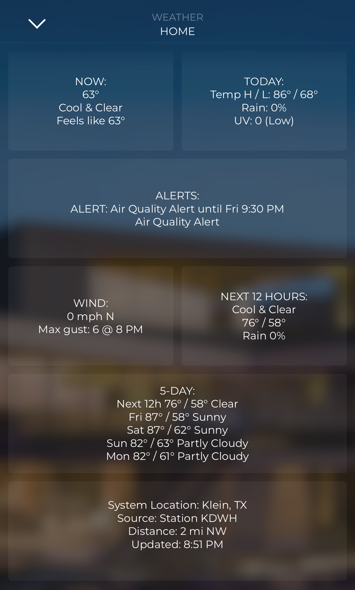

# Savant OpenWx

Free internet weather for Savant: current conditions, 3/12/24-hour and 5-day forecasts, sunrise/sunset, and National Weather Service watches and warnings, delivered as **248 Blueprint states**, refreshed every 5 minutes. Use them in custom-screen labels and triggers (retract shades on high gusts, pool freeze protection, close the pergola before rain…).



- **No account or key needed in the US**: NWS, EPA and US Naval Observatory data, plus MET Norway. Commercial use is allowed (see the manual's licensing section).
- **Worldwide, optionally:** enter an Open-Meteo API key.
- **Runs on the Savant Mac mini Pro host** as a small background service (Python standard library, ~25 MB), with a memory watchdog, clean shutdown, and a full uninstaller.
- **Settings in Blueprint:** location, contact email, API key and automation thresholds are all state variables on the component.
- **Web dashboard** on port 8642 for tablets and checking.

## Quick start

```
cd savant-openwx/macos
sudo ./install.sh
openwx probe 77002
```

Then in Blueprint:

1. Import `profile/openwx_weatherbridge.xml` (keep the file name).
2. Add **OpenWx WeatherBridge** to the layout and set its Ethernet IP to the host.
3. Enter Location Override and Contact Email.
4. Upload.

**Read [MANUAL.pdf](MANUAL.pdf)** (or [MANUAL.md](MANUAL.md)) for setup, custom screens, automations, troubleshooting and the full state list.

## Package contents

| Path | |
|---|---|
| `MANUAL.pdf`, `MANUAL.md` | User manual |
| `STATES.md` | All 248 states |
| `profile/` | Blueprint profile and its generator |
| `bridge/` | Bridge service, dashboard, default config |
| `macos/` | Installer, uninstaller, `openwx` control command |
| `linux/` | systemd unit |

## License

MIT, see [LICENSE](LICENSE). Savant OpenWx is an independent community project, not affiliated with or endorsed by Savant Systems, Inc. Weather data is provided by the National Weather Service, EPA, US Naval Observatory, MET Norway (CC BY 4.0) and optionally Open-Meteo, under their own terms.
